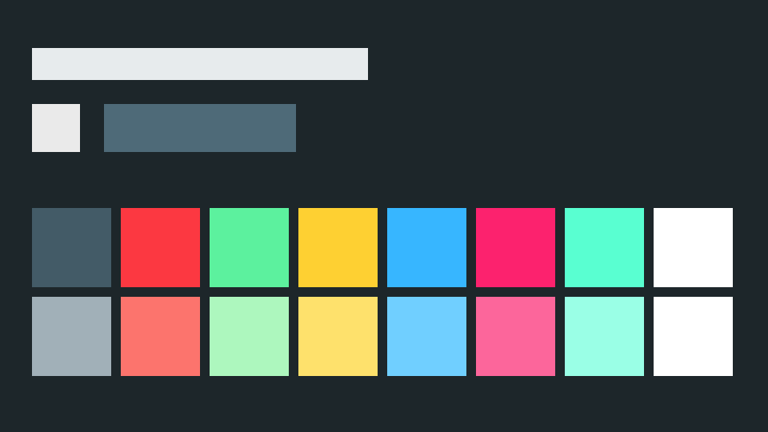

# material-design-colors — terminal theme

A dark slate terminal theme with vivid material-style ANSI colors. Designed for
**CMUX** / **Ghostty**, importable in **iTerm2** and most modern terminals.



| | |
|---|---|
| Background | `#1D262A` |
| Foreground | `#E7EBED` |
| Cursor | `#EAEAEA` (text `#000000`) |
| Selection | `#4E6A78` |
| Palette | 16 ANSI colors — see [`palette.json`](palette.json) |

## Install

### iTerm2

1. Download [`themes/material-design-colors.itermcolors`](themes/material-design-colors.itermcolors)
   (or `curl -LO https://github.com/benjaminbelaga/material-design-colors/raw/main/themes/material-design-colors.itermcolors`).
2. Double-click the file → it appears under **Settings → Profiles → Colors → Color Presets…**
   as `material-design-colors`.
3. Select it to apply. (Manual path: Color Presets… → Import… → pick the file.)

### Ghostty

```bash
mkdir -p ~/.config/ghostty/themes
curl -o ~/.config/ghostty/themes/material-design-colors \
  https://github.com/benjaminbelaga/material-design-colors/raw/main/themes/material-design-colors.ghostty
```

Then in `~/.config/ghostty/config`:

```ini
theme = material-design-colors
```

### CMUX

CMUX reads Ghostty's config format (`config.ghostty`). Either point it at the
Ghostty theme above, or paste the contents of
[`themes/material-design-colors.ghostty`](themes/material-design-colors.ghostty)
directly into your CMUX `config.ghostty` color section.

### Other terminals

| Terminal | File | Install |
|---|---|---|
| kitty | [`themes/material-design-colors.kitty.conf`](themes/material-design-colors.kitty.conf) | `include` it from `kitty.conf`, or copy into `~/.config/kitty/themes/` and `theme material-design-colors` |
| Alacritty | [`themes/material-design-colors.alacritty.toml`](themes/material-design-colors.alacritty.toml) | `[import]` from `alacritty.toml`, or copy the `[colors]` block |
| Warp | [`themes/material-design-colors.warp.yaml`](themes/material-design-colors.warp.yaml) | Drop into `~/.warp/themes/`, pick in Settings → Appearance |
| WezTerm | [`themes/material-design-colors.wezterm.toml`](themes/material-design-colors.wezterm.toml) | Copy to `~/.config/wezterm/colors/material-design-colors.toml`, set `color_scheme = "material-design-colors"` |

## Repository layout

- `palette.json` — single source of truth for every color.
- `themes/*` — generated projections, one file per terminal.
- `scripts/generate.py` — regenerates all theme files from `palette.json`:

```bash
python3 scripts/generate.py
```

## Credits

Designed by Benjamin Belaga.

## License

MIT
